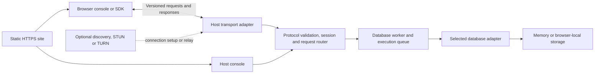

# PocketDB target architecture

PocketDB distributes a static website that lets a browser host a database. The host browser owns execution and default storage. Other clients send requests through a replaceable transport. Signalling and relay services can assist connections. Database execution, persistence, authorization and administration stay on participating devices.

This is the target design distilled from the [engineering handoff, sections 3, 6, 8–16 and 22–24](../handoff.md). Technical choices are tracked in the [decision summary](../decisions/). M0 passed conditionally; M1 local runtime implementation is underway.

## Hosted Mode

1. The host opens the site, selects an engine and starts an instance. The runtime registers adapters, reports capabilities and owns instance and session lifecycle. The runtime design accommodates multiple instances even if the initial host UI exposes one.
2. The host creates an invitation containing a scoped capability. The client resolves the invitation, establishes a connection and authenticates. The host binds access to the expected peer, instance and role before accepting engine operations.
3. The host validates the envelope and enforces session permissions and resource limits. The runtime dispatches the operation to the appropriate engine session. Engine execution runs in a worker where supported.
4. The host returns a correlated result or structured error. The client tracks connection and request outcomes. A lost response can leave a mutation's outcome unknown.
5. Persistent instances can recover after a normal reload on a supported browser. Other browser clients can reconnect while the host is available. Local persistence and portable snapshots serve different recovery needs.

## Component boundaries

| Component | Owns | Boundary |
| --- | --- | --- |
| Host and client consoles | Start/join flows, capability-driven controls, results and diagnostics | Use the runtime or SDK interfaces |
| SDK | Invitation intake, connection lifecycle, typed operations, timeouts and structured errors | Imports shared contracts without importing the web app. Browser and Node transports are isolated. |
| Transport and discovery | Peer connection state, byte delivery, flow control, signaling exchange and ICE configuration | Engine-independent. Replaceable signaling and discovery interfaces feed the WebRTC transport. |
| Protocol and sessions | Encoding, version and capabilities, correlation, validation, authentication and authorization | Protocol types stay independent of UI. `packages/remote-access` routes authenticated requests through the host dispatcher. |
| Runtime and worker | Engine selection, instance and session lifecycle, bounded request queue, cancellation, health and shutdown | `packages/runtime` implements worker RPC. Workers own execution and coordinate access to persistent instances. |
| Engine and persistence adapters | Engine-specific execution, transactions, supported capabilities and data formats | Engines stay independent of UI and networking. Prefer engine-native persistence where appropriate. |
| Observability | Local metrics, structured events and sanitized diagnostic export | Default logging redacts secrets and query parameters. External telemetry is opt-in if introduced. |

The [runtime package](../../packages/runtime/README.md) covers engine identity, capabilities, instance startup and shutdown, session open and close, execution, health, structured errors and optional snapshot export. The [`@pocketdb/engine-kv` package](../../packages/engine-kv/README.md) provides the P0 key-value engine. The [`@pocketdb/protocol` package](../../packages/protocol/) implements the versioned browser envelope and bounded typed-value codec described in the [v1 protocol spec](../specs/protocol-v1.md). The [`@pocketdb/transport`](../../packages/transport/README.md) defines byte delivery and connection lifecycle contracts with a deterministic in-process adapter and reusable contract suite. Portable snapshots follow [ADR-015](../decisions/ADR-015-snapshot-formats-and-restore.md). Engine-specific operations remain at adapter boundaries. Replaceable HTTPS room signaling and configurable STUN/TURN discovery feed the WebRTC transport; production service selection and cross-network acceptance remain release gates. See [TASK-026 evidence](../../artifacts/task-026-discovery/README.md).

The [`@pocketdb/engine-yjs` package](../../packages/engine-yjs/README.md)
provides typed, in-memory Distributed Mode replicas using Yjs. The package keeps
CRDT maps, arrays, text and structured documents separate from Hosted Mode SQL
and key-value engine contracts. Authenticated network synchronization and
persistence remain separate M5 components.

## Later deployment shapes

| Mode or integration | Execution and data ownership |
| --- | --- |
| Native clients | A local CLI bridge exposes a supported PostgreSQL or RESP subset to a standard driver. It uses the shared client path to reach the remote browser's engine. |
| Distributed Mode | Authorized peers hold local replicas, edit offline and exchange CRDT updates after reconnecting. Convergence follows the selected CRDT semantics. Membership, revocation and previously retained data have separate rules. |
| Agent integration | MCP or another supported client surface reuses SDK capabilities and the authorization of its connection. |
| Hybrid Mode | Research track for hosted SQL, distributed metadata and replicated state. Host migration remains exploratory. |

See the [hosted runtime spec](../specs/hosted-runtime.md), [remote access spec](../specs/remote-access.md) and [later-release specs](../specs/later-releases.md) for observable behavior and evidence requirements.
