# Dependency graph

Ticket front matter in the [board](../board/) defines the complete hard dependency graph. An arrow below runs from prerequisite to dependent and can summarize several hard edges. Dashed arrows show preferred release ordering.

```mermaid
flowchart LR
    Plan["TASK-001 delivery plan"] --> Static["TASK-002 static probe"]
    Plan --> RTC["TASK-003 WebRTC and KV probe"]
    Static --> Access["Storage and PostgreSQL session probes"]
    RTC --> Network["Discovery, identity and Node probes"]
    Access --> Feas["TASK-012 M0 and initial ADRs"]
    Network --> Feas
    Access --> Bridge["Early PostgreSQL and RESP bridge probes"]
    Network --> Bridge
    Bridge --> Feas
    Feas --> Foundation["TASK-013 workspace"]
    Foundation --> Local["Runtime, engines, workers and persistence"]
    Foundation --> Remote["Protocol, WebRTC and invitations"]
    Local --> LocalGate["TASK-022 M1 local runtime"]
    Remote --> Route["Authenticated routing and SDK"]
    Local --> Route
    LocalGate --> Peer["TASK-032 M2 two-device proof"]
    Route --> Peer
    Peer --> Release["TASK-043 M3 hackathon release"]
    Route --> Harden["Recovery, dashboard and deployment"]
    Harden --> Release
    Peer --> Node["TASK-044 Node.js client"]
    Node --> Native["TASK-049 M4 native drivers"]
    Peer --> Replica["TASK-054 M5 convergence"]
    LocalGate --> Engines["M6 selected adapters"]
    Static --> Engines
    Native -. preferred .-> Replica
    Release -. preferred .-> Native
    Replica -. preferred .-> Engines
    Node --> Agent["TASK-064 M7 agent proof"]
    Engines -. preferred .-> Agent
```

At the current base estimates, one longest hard path to the hackathon release is **51 engineer-days** at perfect parallelism elsewhere. It runs through TASK-001 → TASK-002 → TASK-005 → TASK-006 → TASK-012 → TASK-013 → TASK-024 → TASK-025 → TASK-028 → TASK-029 → TASK-030 → TASK-031 → TASK-038 → TASK-039 → TASK-041 → TASK-043. TASK-001 is complete and contributes zero remaining effort. The PostgreSQL wire spike has a branch of equal length into TASK-012.

Parallel opportunities include static hosting and WebRTC probing, discovery and storage investigation, engine adapters after the engine contract, protocol and transport development alongside the local runtime, and documentation alongside release hardening. After M2, native integration and CRDT experimentation can proceed independently. Keep team capacity focused on M3 release evidence if those later tracks compete with it. See the [ADR backlog](ADR_BACKLOG.md) for decisions that must precede dependent production code.
